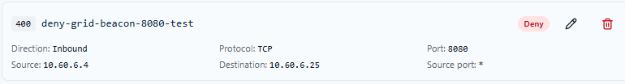
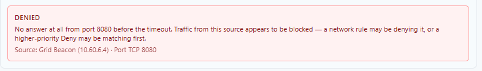
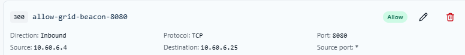
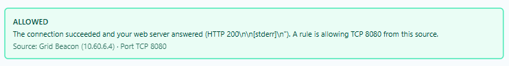

# Week 7 Lab 05 — Break It, Explain It, Fix It

**Student Name:** Ashley Raether

**Date Completed:** 10/31/2026

**Module:** 2 — Networking & Cloud Foundations | **Week:** 7  
**Submission Path:** `week-07/labs/lab-05-break-explain-fix.md`

> ## Cloud Heights Protected-Rules Safety Rule
> Your room uses one of two protected baselines. Check your own **INBOUND — EVALUATION ORDER** list to see which one you have:
>
> | Baseline | Protected rules you will see | Fallback for TCP 8080 |
> |---|---|---|
> | **Legacy (four rules)** | 100 `allow-ssh-from-bastion`, 110 `allow-icmp-intra-vnet`, 120 `deny-ssh-student-subnet`, 1000 `deny-tcp8080-student-subnet` | Priority **1000** denies TCP 8080 from `10.60.6.0/26` |
> | **Newer (three rules)** | 100 `allow-ssh-from-bastion`, 110 `allow-icmp-intra-vnet`, 4096 `deny-other-inbound` | Priority **4096** explicitly denies all other inbound traffic (any protocol, source and port) |
>
> **Protected** rules (priorities 100/110, plus 120 and 1000 in legacy rooms, or 4096 in newer rooms) are course infrastructure: they are locked, and you must never modify them. Azure also has built-in default rules (priorities 65000–65500) that the Portal does not list; do not record them unless your ledger actually shows them. **Your editable range is 200–999.** Every student rule is read before either fallback. Write down the rule set your Portal actually shows; do not copy rules from the other baseline or invent missing ones. Use only inbound TCP 8080 rules from `10.60.6.4` to your assigned VM in Labs 03–05; never create SSH, ICMP, Any-protocol or outbound rules for these exercises. Bastion SSH and ICMP are matched by the earlier protected allows at 100/110 in both baselines. Honest diagnosis of a student-range mistake is not a grading penalty.

> **Evidence safety:** Never include a Cloud Heights password or Bastion shareable URL. Crop browser address bars and login information before committing screenshots.

---

## Mission

Create a controlled priority failure inside your student range, diagnose it from evidence, remove the problem, and retest. The goal is method: UNDERSTAND → PREDICT → CHANGE → TEST → VERIFY, then FORECAST → EXECUTE → VERIFY → REMEDIATE → RETEST.

## What You Already Know

A network security rule is a decision about traffic. Rules are evaluated from the lowest priority number to the highest, and the first matching rule wins. Inbound and outbound traffic use separate ledgers. A configured service, a security rule, a test result, and an evidence screenshot answer different questions.

## Lab Environment / Pre-Lab Check

| Component | Details |
|---|---|
| Required setup | Lab 03 narrow Allow present; listener running |
| Safe failure | Student-created Deny only; every actual protected baseline rule untouched |
| Temporary rule priority | An unused number lower than your Lab 03 Allow, within 200–999 (example: Allow 300 → Deny 250) |
| Time | 45–55 minutes |

- [x] I am using my assigned `cf-student-XX` VM through the CyberFoundations Lab Portal.

- [x] The VM shows **Running**.

- [x] I can identify every protected rule in my actual baseline (legacy 100/110/120/1000 or newer 100/110/4096).

- [x] I understand that my editable priority range is 200–999.

### Cloud Heights Idle Stop

Cloud Heights may warn you that the VM is idle. Return to the Lab Portal and choose **I'm still working** if you are active. If the VM is stopped or deallocated, it was not deleted: restart it from **My Lab Environment**. Your disk files and saved configuration remain.

## UNDERSTAND

Your working Lab 03 Allow is at a priority you chose (often 300). A new matching Deny with a **lower** number is evaluated first and makes the later Allow unreachable for that traffic.

**Choose your fault priority before you change anything.**

1. Look up the priority of your Lab 03 Allow in your ledger.
2. Pick an **unused** number that is lower than that Allow and still at least 200. Example: Allow 300 → Deny 250. Allow 450 → Deny 400.
3. **If your Allow is at 200, or every lower number from 200 up is already used, stop and ask your instructor before making any change.** Do not move, edit or delete your Allow on your own, and never reuse an occupied priority.

In the rest of this lab, *your fault priority* means the number you chose here.

## Predict First — FORECAST

Write your Allow priority and your chosen fault priority, then predict Grid Beacon's verdict after adding an inbound Deny for TCP 8080 from `10.60.6.4` at your fault priority, while leaving the working Allow in place.

```text
The allowed priority is 300. The Grid Beacon's verdict after adding an inbound Deny for TCP is that the Grid Beacon is deny, it won't respond back to the Python listener. The Grid Beacon IP address is mandatory, and it needs to be allowed since it is a legitimate IP address.
```

## CHANGE / EXECUTE

### Step 1 — Create the Temporary Fault

Create a student rule named `deny-grid-beacon-8080-test`:

- priority: your chosen fault priority — unused, lower than your Lab 03 Allow, and within 200–999
- Inbound / Deny / TCP
- source `10.60.6.4`; source port Any
- destination your assigned VM name or recorded private IP; destination port `8080`
- description: intentional Week 7 troubleshooting fault

Do not edit or delete the Lab 03 Allow. Do not touch any protected rule — your actual fallback (1000 legacy or 4096 newer) stays unchanged throughout this lab.

### Step 2 — Capture the Broken Ledger

Capture both your temporary Deny (at your fault priority) and the later Allow in the same ordered rule view, so the screenshot shows the Deny listed first.

## TEST / VERIFY

Wait at least 10 seconds, select Grid Beacon, and run **Test My Rule**. Expected verdict: `DENIED`.

```text
DENIED

No answer at all from port 8080 before the timeout. Traffic from this source appears to be blocked — a network rule may be denying it, or a higher-priority Deny may be matching first.

Source: Grid Beacon (10.60.6.4) · Port TCP 8080
```

### Stop & Check — Diagnose Before Fixing

Confirm these healthy facts before remediation:

- VM is Running.
- Python listener is still active on 8080.
- The original Allow is still present and correctly scoped.
- The temporary Deny has a lower priority number than the Allow, so it is evaluated first.

```text
The service stopped; the Python Listener did not get a response back from the Grid Beacon. The number is lower than the Other Test Source.
```

## REMEDIATE

Delete only the temporary `deny-grid-beacon-8080-test` rule you created. Removing the controlled fault returns the ledger to the known-good least-privilege state. Refresh only rereads rules; there is no portal baseline-reset button. Restarting a VM does not reset its rules. To return to the initial baseline after evidence is complete, remove only your own Week 7 student rules, never infrastructure rules. For this lab's retest, keep the narrow Allow and remove only the temporary Deny.

## RETEST

1. Wait at least 10 seconds and retest Grid Beacon: expected `ALLOWED`.
2. Wait at least 10 seconds and retest Other Test Source: expected `DENIED`.

```text
The Grid Beacon is allowed.
The Other Test Source is denied.
```

## Capture Evidence

Your sequence must show broken rules, observed denial, repaired rules, and final retest results.









## Explain — Incident Note

```text
Problem: The student did not know that the Grid Beacon is not a  legitimate rule, the student denied the rule.
Evidence: The student accidentally changed the settings to denied as an option instead of allow. The settings of the rule changed from allow to deny.
Healthy conditions ruled out: The Azure Bastion VM is healthy and running.  The Python listener has no troubleshooting issues.
Root cause: The student is confused about whether the rule is allowed or deny.
Remediation: Delete the rule the student created and re-create the Grid Beacon's settings from deny to allow., Another option is edit the rule and rename it the rule from deny to allow, change the settings from deny to allow.
Retest: Retesting by starting the Python listener in Azure Bastion and retesting the Grid Beacon rule, the Grid Beacon is now allow to respond to the Python listener.
Prevention: To prevent it, the student can ask the instructor for help asking whether the rule is allowed or not,
```

## Required Evidence

Save screenshots in `assets/screenshots/week-07/`:

- `week07-lab05-broken-rules.png`
- `week07-lab05-observed-denial.png`
- `week07-lab05-fixed-rules.png`
- `week07-lab05-retest-results.png`

Open each image at full size before submission. Confirm that no password, Bastion shareable URL, browser address bar, or unrelated private information is visible.

## Analysis Questions

**Analysis Question 1.** Why did the correct Allow stop working even though it was never edited? (Minimum 4 sentences.)

```text
The correct allow rule stops working, but it is not edited because the rule has the same information but both of them say allow and deny. The first time you test the rule, it will say allow, but when you test again, it will say deny. The evaluation order list is confusing; the rule is either allowed or denied. The person who added the rule is confused about whether the rule is legitimate or not.
```

**Analysis Question 2.** Why is diagnosing from evaluation order better than changing rules by trial and error? (Minimum 4 sentences.)

```text
Diagnosing from the evaluation order is better than changing rules by trial and error, because diagnosing the evaluation order has a rule that allows us to help diagnose the Azure Bastion VM incase the VM fails or has troubleshooting problems. Changing the rule will take a lot of time and effort to change the rules settings. It will be the best way to delete the rule and re-create the rule. Sometimes the evaluation order won't let you modify the rule settings.
```

**Analysis Question 3.** What made this failure safe and recoverable in the course environment? (Minimum 3 sentences.)

```text
The failure is safe and recoverable in the course environment; the failures can be safe if the rule is not safe to be in the evaluation list. If the unsafe rule is accidentally allowed on the evaluation list, the guard will recognize the rule and delete it from the evaluation list. It is hard to tell whether the rule is allowed or denied.
```

## Submission Checklist

- [x] Forecast written before the change

- [x] Temporary fault used an unused priority lower than my Lab 03 Allow and within 200–999 (or I asked my instructor first)

- [x] Broken ledger and DENIED result captured

- [x] VM, listener, and original Allow checked before remediation

- [x] Only the temporary Deny removed

- [x] Grid Beacon retested `ALLOWED` and Other Test Source retested `DENIED`

- [x] Incident note completed

- [x] All protected rules in my actual baseline were left unchanged.

- [x] Every rule I created or edited used priority 200–999.

- [x] No password, Bastion URL, or browser address bar appears in my files.

- [x] This worksheet is committed to `week-07/labs/lab-05-break-explain-fix.md`.

## GitHub / Lab Portal Submission

1. Open **Week 7 → Lab 05: Break It, Explain It, Fix It** in the CyberFoundations Lab Portal.
2. Complete every worksheet field and confirm the listed evidence filenames.
3. Upload screenshots to `assets/screenshots/week-07/`.
4. Confirm your portfolio repository is connected, then choose **Submit to GitHub**.
5. Open the committed worksheet and each image on GitHub to verify formatting, legibility, and redaction.

*CyberVisionaries Institute · CyberFoundations · Tier I*

**Interpreting results:** A TCP connection success proves reachability at that moment, not which rule matched. A timeout marked DENIED means traffic appears blocked; it is not a flow-log verdict and can also reflect a routing or host-firewall problem. SERVICE_NOT_LISTENING means an immediate refusal; check the listener before altering rules. TEST_ERROR is not denial evidence. Each test opens a fresh connection; after a rule change, allow Azure to finish, refresh the ledger and wait at least 10 seconds before retesting. Never invent a successful or denied result.
