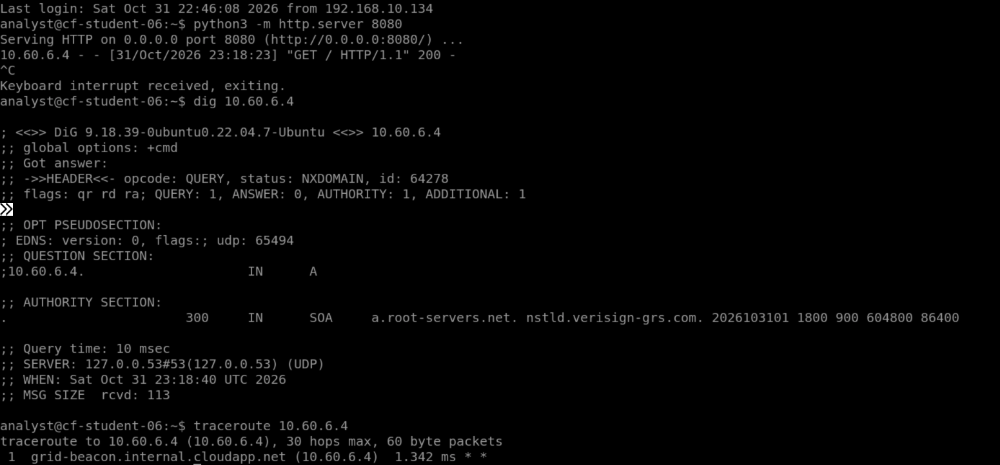

# Week 7 Lab 06 — Night Watch — Optional Stretch

*The Logbook*

**Student Name:** Ashley Raether

**Date Completed:** 10/31/2026

**Module:** 2 — Networking & Cloud Foundations | **Week:** 7  
**Submission Path:** `week-07/labs/lab-06-stretch-night-watch.md`

> ## Cloud Heights Protected-Rules Safety Rule
> Your room uses one of two protected baselines. Check your own **INBOUND — EVALUATION ORDER** list to see which one you have:
>
> | Baseline | Protected rules you will see | Fallback for TCP 8080 |
> |---|---|---|
> | **Legacy (four rules)** | 100 `allow-ssh-from-bastion`, 110 `allow-icmp-intra-vnet`, 120 `deny-ssh-student-subnet`, 1000 `deny-tcp8080-student-subnet` | Priority **1000** denies TCP 8080 from `10.60.6.0/26` |
> | **Newer (three rules)** | 100 `allow-ssh-from-bastion`, 110 `allow-icmp-intra-vnet`, 4096 `deny-other-inbound` | Priority **4096** explicitly denies all other inbound traffic (any protocol, source and port) |
>
> **Protected** rules (priorities 100/110, plus 120 and 1000 in legacy rooms, or 4096 in newer rooms) are course infrastructure: they are locked, and you must never modify them. Azure also has built-in default rules (priorities 65000–65500) that the Portal does not list; do not record them unless your ledger actually shows them. **Your editable range is 200–999.** Every student rule is read before either fallback. Write down the rule set your Portal actually shows; do not copy rules from the other baseline or invent missing ones. Use only inbound TCP 8080 rules from `10.60.6.4` to your assigned VM in Labs 03–05; never create SSH, ICMP, Any-protocol or outbound rules for these exercises. Bastion SSH and ICMP are matched by the earlier protected allows at 100/110 in both baselines. Honest diagnosis of a student-range mistake is not a grading penalty.

> **Evidence safety:** Never include a Cloud Heights password or Bastion shareable URL. Crop browser address bars and login information before committing screenshots.

---

## Mission

Turn the evidence already exposed by the Lab Portal into a short analyst logbook. The current student Portal does not expose a VNet flow-log viewer, so this lab does not ask you to locate or interpret one. Work only with visible security-rule state and **Test My Rule** results.

**Optional stretch:** Skipping this lab, or leaving out its evidence, does not reduce your grade.

## What You Already Know

A network security rule is a decision about traffic. Rules are evaluated from the lowest priority number to the highest, and the first matching rule wins. Inbound and outbound traffic use separate ledgers. A configured service, a security rule, a test result, and an evidence screenshot answer different questions.

## Lab Environment / Pre-Lab Check

| Component | Details |
|---|---|
| Evidence available | Security Rules list and Test My Rule result cards |
| Not available | Student-facing VNet/NSG flow-log viewer |
| Change level | No new rule changes required |
| Time | 20–30 minutes; optional |

- [x] I am using my assigned `cf-student-XX` VM through the CyberFoundations Lab Portal.

- [x] The VM shows **Running**.

- [x] I can identify every protected rule in my actual baseline (legacy 100/110/120/1000 or newer 100/110/4096).

- [x] I understand that my editable priority range is 200–999.

### Cloud Heights Idle Stop

Cloud Heights may warn you that the VM is idle. Return to the Lab Portal and choose **I'm still working** if you are active. If the VM is stopped or deallocated, it was not deleted: restart it from **My Lab Environment**. Your disk files and saved configuration remain.

## Predict First

Predict which conclusion can be supported by each artifact: a rule screenshot, an `ALLOWED` result, a `DENIED` result, and the Python listener output.

```text
The allowed rule is Grid Beacon; the denied rule is Other Test Source.
```

## Guided Steps

### Step 1 — Build the Evidence Chain

Use your Week 7 screenshots to identify:

1. **Configuration:** what the rule was designed to permit or deny.
2. **Enforcement result:** what the Portal test reported.
3. **Observed behavior:** whether the test source reached TCP 8080.
4. **Evidence artifact:** which screenshot supports the claim.

| Claim type | Claim | Supporting file | Limitation |
| --- | --- | --- | --- |
| Configuration | Grid Beacon  | evaluation order | one test at a time |
| Enforcement | Azure Bastion VM | terminal  | accepts one rule test, not multiple. |
| Observed behavior | the test reached the TCP 8080 | protocol  | Only one protocol allowed for testing. |

### Step 2 — Write a Night-Watch Entry

**Date/time recorded by student:** 10/31/2026, 3:46p.m

**VM identifier:** Azure Bastion

**Rule reviewed:** Grid Beacon

**Intended source and port:** HTTP

**Allowed-source result:**   "GET / HTTP/1.1" 200 -

**Unintended-source result:** No Unintended-source results

**Conclusion:** The Python listener received a message from a webserver.

```text
The conclusion is that the user runs the Python Lister on the Azure Bastion VM, the user runs the Grid Beacon test, and the Python listener receives the message from the Grid Beacon. 
```

**Evidence filenames:** The ip address belongs to a Linux Machine

### Step 3 — Name the Visibility Gap

Explain what you cannot conclude without a student-facing flow-log or audit viewer. Do not invent timestamps, packet records, or traffic history that the Portal does not show.

```text
I cannot conclude the students' rules; deny-ssh-student-subnet and deny-tcp8080-student-subnet rules. The students' rules are deny, the rules are not in the logbook. The students' do not own the Azure Bastion VM, the VM is for educational purposes only. You can not conclude every rule in the book; only trusted and certain rules are allowed.
```

## Stop & Check

A rule list shows intended configuration. A test result shows one controlled test outcome. Neither is a complete history of all traffic.

## Test

No new test is required. If you repeat tests, keep the listener running, wait at least 10 seconds between tests, and use only the two Portal-provided sources.

## Capture Evidence

Choose **one** option. Do not fabricate a flow-log screenshot.

- **Option A — new image:** create one organized screenshot named `week07-lab06-evidence-set.png` and paste its link below.
- **Option B — reuse:** reuse the exact screenshots you already submitted in Labs 03–05. You do not need a new image; leave the image link below empty and list the reused files in the evidence table instead.

**Evidence table.** Write which option you used. For Option B, list each reused file (one per line: filename — lab — claim it supports), using its exact filename from `assets/screenshots/week-07/` (for example `week07-lab04-grid-beacon-allowed.png`, `week07-lab05-observed-denial.png`).

```text
I choose Option A for new evidence.
```



## Explain

Write an analyst-style conclusion that clearly separates what is proven, what is inferred, and what remains unknown.

```text
The new evidence I found is that the Python listener got a response back from an unknown web server. The Python listener did not tell the website's name. The Python listener did not send a message back. The Python listener got the Grid Bastion request; it shows the IP address. The Grid Bastion sends a message to the Python listener on the Azure Bastion VM. I can use the dig command what device the IP is coming from and traceroute where is the IP address located.
```

## Required Evidence

Save screenshots in `assets/screenshots/week-07/`:

- Option A: `week07-lab06-evidence-set.png`, **or**
- Option B: the exact Labs 03–05 filenames listed in your evidence table (no new image needed)

Open each image at full size before submission. Confirm that no password, Bastion shareable URL, browser address bar, or unrelated private information is visible.

## Analysis Questions

**Analysis Question 1.** How is a security rule different from a record of traffic that actually occurred? (Minimum 3 sentences.)

```text
A security rule is different from a record of traffic, the security rule is rules of the Azure Bastion must follow. The student can not make the rules since the Azure Bastion VM is not owned by students. The Azure Bastion VM has rules configured by the admin who owns the Azure Bastion VM.
```

**Analysis Question 2.** What can a single Test My Rule result prove, and what can it not prove? (Minimum 4 sentences.)

```text
A single test: My rule is to test whether the rule is allowed or denied from the Azure Bastion VM. The Grid Beacon rule is the rule is allowed; the other test source rule is denied; the other test source you can decided the other test source can be allowed or denied. The other test source rule is not proved; the user does not know where the rule come from.
```

**Analysis Question 3.** Why is naming a visibility gap more professional than filling it with an assumption? (Minimum 3 sentences.)

```text
Naming a visibility gap is more professional than filling it because naming the visibility gap with a professional name will make it less likely the rule gets rejected. The analyst gets confused when the rule is not named professionally. The analyst is assured the rule should be named professionally when someone adds the rule to the system. The other test source is a great example; the name is unprofessional.
```

## Submission Checklist

- [x] Configuration, enforcement, observed behavior, and evidence distinguished

- [x] Night-watch entry completed

- [x] Portal visibility gap stated accurately

- [x] No flow-log viewer or traffic history invented

- [x] Evidence filenames verified (new evidence-set image or exact reused Labs 03–05 filenames)

- [x] All protected rules in my actual baseline were left unchanged.

- [x] Every rule I created or edited used priority 200–999.

- [x] No password, Bastion URL, or browser address bar appears in my files.

- [x] This worksheet is committed to `week-07/labs/lab-06-stretch-night-watch.md`.

## GitHub / Lab Portal Submission

1. Open **Week 7 → Lab 06: Night Watch — Optional Stretch** in the CyberFoundations Lab Portal.
2. Complete every worksheet field and confirm the listed evidence filenames.
3. Upload screenshots to `assets/screenshots/week-07/`.
4. Confirm your portfolio repository is connected, then choose **Submit to GitHub**.
5. Open the committed worksheet and each image on GitHub to verify formatting, legibility, and redaction.

*CyberVisionaries Institute · CyberFoundations · Tier I*

**Interpreting results:** A TCP connection success proves reachability at that moment, not which rule matched. A timeout marked DENIED means traffic appears blocked; it is not a flow-log verdict and can also reflect a routing or host-firewall problem. SERVICE_NOT_LISTENING means an immediate refusal; check the listener before altering rules. TEST_ERROR is not denial evidence. Each test opens a fresh connection; after a rule change, allow Azure to finish, refresh the ledger and wait at least 10 seconds before retesting. Never invent a successful or denied result.
